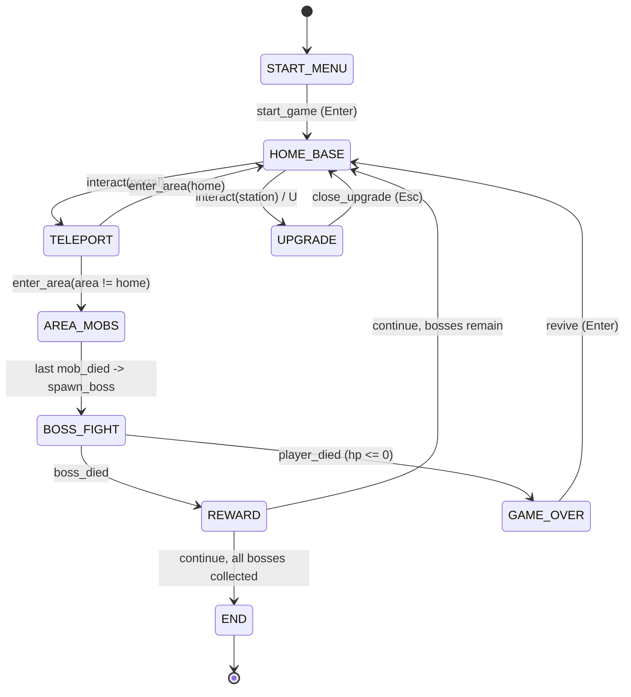

# 2D Top-Down RPG Skeleton — pygame + SPADE

A minimal but *runnable* skeleton: pygame renders and reads input, SPADE agents
(XMPP) own the game-flow FSM and AI. All graphics are placeholder rectangles
with labels until you drop PNGs into `assets/`.

## Assumptions (v1)

- Python 3.11+, resolution **1280×720**, tile size **32**, sprites 32×32.
- Content: one home base, one area (`green_cave`) with 2 mob types, 1 boss, 1 weapon, upgrade menu.
- SPADE 3.3+ (asyncio-based). XMPP credentials come from `.env` only.
- Agents ↔ game share one Bridge; agents never mutate the pygame state directly.

## Project structure

```
.
├── main.py                # pygame loop + thread wiring (entry point)
├── config.yaml            # window, tile, offline flag, debug
├── .env.example           # XMPP credentials template (copy to .env)
├── requirements.txt
├── data/                  # data-driven content (no code changes needed)
│   ├── enemies.json  bosses.json  weapons.json  areas.json
├── assets/
│   ├── player/ enemies/ bosses/ tiles/ ui/ items/   # drop PNGs here
├── rpg/
│   ├── settings.py        # config/.env loading, ASSUMPTIONS, data loaders
│   ├── assets.py          # AssetManager: PNG or labeled-color fallback
│   ├── models.py          # Stats, Player, Mob, Boss, Weapon, Item
│   ├── inventory.py       # gold, items, weapons, boss collection
│   ├── state.py           # GameState: single source of truth (pygame thread)
│   ├── world.py           # Scene placeholder tilemap + interactables
│   ├── bridge.py          # thread-safe queues pygame <-> SPADE
│   ├── offline.py         # LocalDirector (same flow, no XMPP needed)
│   ├── ui.py              # HUD, overlays (rendering only)
│   └── agents/
│       ├── protocol.py    # message helpers + templates
│       ├── runtime.py     # AgentThread: SPADE in bg thread with own asyncio loop
│       ├── player_agent.py  # PlayerAgent + FSMBehaviour (main flow)
│       ├── world_agent.py   # areas, teleports, spawn orchestration
│       ├── enemy_agent.py   # mobs/bosses AI, attack cooldowns, loot
│       └── shop_agent.py    # upgrades, economy, weapon unlocks
```

## State machine (FSMBehaviour in `rpg/agents/player_agent.py`)



SPADE's `FSMBehaviour` uses `add_state` / `add_transition` + `set_next_state()`
inside each state's `run()`; the "events" in the diagram are the conditions
checked there. The `TRANSITIONS` list in the code mirrors this diagram exactly.

Advanced SPADE behaviours used where they make sense:

| Behaviour | Where | Purpose |
|---|---|---|
| `FSMBehaviour` | PlayerAgent | main game flow (above) |
| `PeriodicBehaviour` | EnemyAgent `AiTick` | mob AI / movement ticks every 0.5 s |
| `PeriodicBehaviour` |	PlayerAgent `Autosave` | autosave every 30 s |
| `TimeoutBehaviour` | EnemyAgent `BossAttack` | boss attack fires once cooldown elapses, re-arms itself |
| `CyclicBehaviour` | `InboxListener`, world/enemy/shop listeners + bridge polling | receive messages continuously |
| `OneShotBehaviour` | `DropLoot`, `UnlockWeapon` | one-off loot drop / weapon unlock |
| `Template` | all listeners | route by `performative` + `ontology` metadata |
| presence | all agents | `presence.set_available()` + `subscribe(peers)` to track who is online |

## Message protocol (XMPP, JSON body)

Every message: `performative` and `ontology: rpg-skeleton` in metadata, a JSON
body `{"type": ..., **payload}`. Body `type` is checked after `parse()` since
SPADE templates cannot match body contents.

| # | From → To | Performative | Body `type` | Payload | Meaning |
|---|---|---|---|---|---|
| 1 | player → world | request | `enter_area` | `area` | request teleport to an area |
| 2 | world → player | inform | `area_opened` | `area` | area validated/entered |
| 3 | world → enemy | request | `spawn_mobs` | `area`, `count` | spawn the area's mobs |
| 4 | enemy → player | inform | `spawn_boss` (as bridge event) | `area`, `boss` | phase 2 begins |
| 5 | player → enemy | request | `attack` / `mob_died` / `boss_died` | `id`, `damage` | combat resolution from pygame |
| 6 | enemy → player | inform | `enemy_attack` | `damage` | boss/mob hit lands (from TimeoutBehaviour cooldown) |
| 7 | enemy → player | inform | `enemy_intent` | `id`, `dx`, `dy` | AI movement tick |
| 8 | player → shop | request | `upgrade` | `target` (`hp|attack|defense|speed|weapon_id`) | buy an upgrade |
| 9 | shop → player | inform | `upgrade_result` | `ok`, `cost` | upgrade accepted / rejected |
| 10 | shop → player | inform | `weapon_unlocked` | `weapon` | OneShot unlock after boss drop |
| 11 | player → world | inform | `save` | — | autosave marker |

The **same payloads** flow through the local `Bridge` as plain dicts
(`rpg/state.py: GameState.apply`), so online and offline modes stay identical.

## Setup

```bash
pip install -r requirements.txt
```

## Run

```bash
python main.py            # offline mode (default in config.yaml): no XMPP needed
python main.py --online   # full multi-agent mode over XMPP
```

Controls: WASD/arrows move, `E` interact (portal/chest/stations), `SPACE`
attack, `U` upgrade menu, `Enter` confirm menus, `Esc/Q` quit.

### XMPP credentials

Copy `.env.example` to `.env`. Two supported modes:

- **Single account (easiest):** set `XMPP_USER`, `XMPP_SERVER`, `XMPP_PASSWORD`.
  All four agents connect as `user@server/<role>` (XMPP resources), so one
  Jabber account is enough. Most servers allow multiple resources.
- **Separate accounts (cleaner):** set `XMPP_PLAYER`, `XMPP_WORLD`,
  `XMPP_ENEMY`, `XMPP_SHOP` + matching `_PASSWORD` vars; each agent gets its
  own JID (`player@server`, `world@server`, ...). Accounts must already exist
  (SPADE's `start(auto_register=True)` can also try in-band registration).

Set `offline: false` in `config.yaml` (or use `--online`) to enable agents.

### Testing the XMPP connection

```bash
python -c "import asyncio, spade, yaml, os
from dotenv import load_dotenv; load_dotenv()
from rpg.settings import load_settings
async def t():
    s = load_settings()
    a = spade.agent.Agent(s.jids['player'], s.passwords['player'])
    await a.start(auto_register=True)
    print('CONNECTED as', a.jid, '| available:', a.presence.is_available())
    await a.stop()
asyncio.run(t())"
```

Expect `CONNECTED as player@your.server/player`. If your server blocks
multi-resource logins, use separate accounts (Option B).

### How pygame + SPADE coexist

SPADE requires a running asyncio loop; pygame blocks the main thread with its
real-time loop. Solution (`rpg/agents/runtime.py`): agents live in a daemon
`threading.Thread` with `asyncio.new_event_loop()`; `main.py` keeps the pygame
loop on the main thread. All communication goes through two `queue.Queue`s
(`rpg/bridge.py`), so no shared mutable state and no extra locks are needed.
`GameState` is only ever mutated in the pygame thread, via `GameState.apply(event)`.

## How to extend

- **New area:** add an entry to `data/areas.json` (`mobs`, `mob_count`, `boss`,
  `map`, `color`), and a portal interactable in `rpg/world.py: home_scene`
  named `portal_<area_id>`. No logic changes needed.
- **New mob/boss/weapon:** add JSON entries in `data/enemies.json`,
  `data/bosses.json`, `data/weapons.json`. Bosses can carry `"weapon": "<id>"`
  to drop it. Kill all bosses → END screen auto-updates (it compares against
  `data/bosses.json` keys).
- **New FSM state:** subclass `BaseState` in `player_agent.py`, add it to
  `STATES`, register transitions in `TRANSITIONS`, add a matching phase constant
  in `rpg/state.py` if the game side must react, and update the Mermaid diagram.
- **Real art:** drop `player.png`, `slime.png`, `golem_king.png`, `sword.png`,
  etc. into the matching `assets/` subfolder (32×32 recommended). Missing files
  fall back to labeled colored rectangles automatically.
- **TODO markers** in the code (`# TODO`) show intended places: loot tables,
  tile rendering, save-to-disk, weapon ranges, real tiles.
